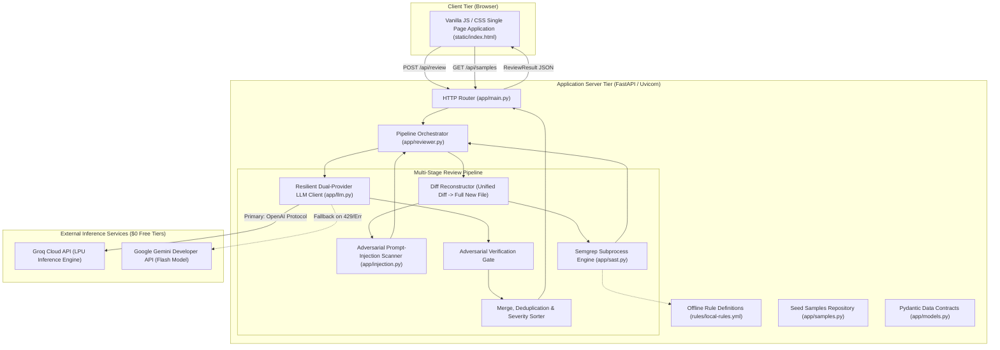
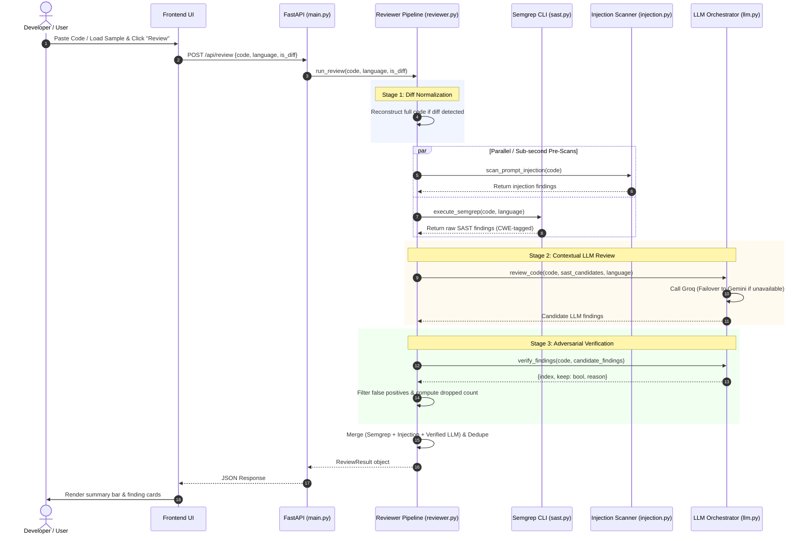

# SentinelReview — System Architecture & Topology

## 1. System Overview & Component Boundaries

SentinelReview employs a layered, pipeline-driven architecture designed to balance deterministic static analysis speed with LLM contextual reasoning. The application runs as a unified FastAPI service hosting both static assets and API endpoints.



---

## 2. Pipeline Execution Flow



---

## 3. Data Flow & Contract Architecture

### 3.1 Review Request Schema
```python
class ReviewRequest(BaseModel):
    code: str
    language: str = "Python"
    is_diff: bool = False
```

### 3.2 Finding Item Schema
```python
class Finding(BaseModel):
    category: Literal["bug", "security", "style"]
    severity: Literal["high", "medium", "low"]
    confidence: float  # 0.0 to 1.0
    line: Optional[int] = None
    title: str
    explanation: str
    suggested_fix: str
    cwe: Optional[str] = None
    source: Literal["semgrep", "llm", "injection-scan"]
```

### 3.3 Final Output Schema
```python
class ReviewCounts(BaseModel):
    high: int = 0
    medium: int = 0
    low: int = 0
    false_positives_filtered: int = 0

class ReviewResult(BaseModel):
    summary: str
    counts: ReviewCounts
    provider_used: Literal["groq", "gemini", "sast-only"]
    findings: List[Finding]
```

---

## 4. Key Architectural Safeguards
1. **Zero External Vector DB Overhead**: Full pasted files fit comfortably in 128k/1M context windows, eliminating embedding drift, vector sync, and memory bloat on 8GB machines.
2. **Ephemeral File Isolation**: Semgrep temp files are generated with randomized unique names and cleaned up in a `finally` block to prevent disk pollution.
3. **Resilient JSON Parser**: Handles markdown fences (` ```json `), regex boundary extraction, and a single self-repair round to eliminate serialization failures.
4. **Idempotent Merge & Deduplication**: Merges Semgrep, injection, and LLM findings by normalizing `(line, title)` signatures, sorting by severity (`high > medium > low`).
